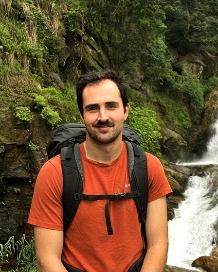

Hi! I'm a third-year PhD student at Helmholtz Munich, advised by [Steffen Schneider](https://stes.io/).

My research explores how we can **learn world models that capture the underlying dynamics of complex systems**, particularly in scientific domains such as **neuroscience**. I develop self-supervised learning methods that recover meaningful and identifiable representations and dynamics from high-dimensional, nonlinear observations.

Long term, I want to bridge representation learning, dynamical systems and scientific discovery, so we can go from complex observations to models that help us understand, predict and control real-world systems.

[Website](https://gonlairo.github.io) · [Google Scholar](https://scholar.google.com/citations?user=W4uotzoAAAAJ&hl=en) · [Email](mailto:rodrigo.gonzalezlaiz@helmholtz-munich.de)
